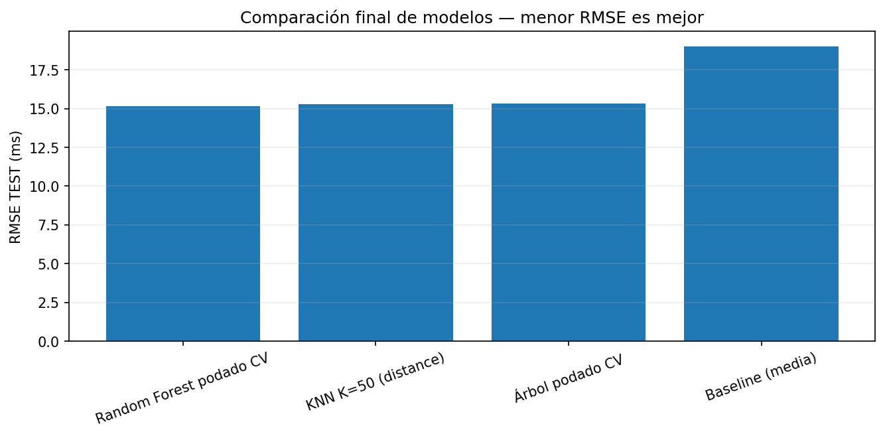

# Machine Learning – Análisis comparativo (Entrega #1)

Proyecto de aprendizaje automático que compara **Árbol de Decisión**, **Random Forest** y **KNN** en dos problemas supervisados (regresión y clasificación binaria) y complementa el análisis con un agrupamiento no supervisado mediante **K-Means**.

El informe completo se encuentra en [`Informe Entrega.pdf`](Informe%20Entrega.pdf).

**Autores:** Daniel Felipe Sánchez Perafan · Juan Manuel Rivera · Nestor David Torres Rojas
**Docente:** Jesús Emilio Pinto Lopera
Universidad de la Amazonia — Facultad de Ingeniería — Programa de Ingeniería de Sistemas, Florencia, Caquetá (2026-1)

---

## Estructura del repositorio

```
.
├── Informe Entrega.pdf
├── Base1_Regresion_CV_Modificado_COMPLETO/
│   ├── Base1_Regresion_EsportsBiometrics_CV_Modificado.ipynb
│   ├── data/esports_biometrics.csv
│   └── resultados_regresion/          # figuras (fig_*.png) y tablas (tabla_*.csv)
└── Base2_Clasificacion_KMeans_COMPLETO_1/
    ├── Base2_Clasificacion_HotelBookings_KMeans.ipynb
    ├── helpers.py
    ├── data/                          # hotel_bookings_*.csv y particiones .parquet
    └── resultados_clasificacion/      # figuras y tablas de clasificación y K-Means
```

## Problemas abordados

| Problema | Dataset | Variable objetivo | Tipo |
|---|---|---|---|
| Regresión | Biometría de jugadores de e-sports (250.000 registros, 13 variables) | `Reaction_Time_ms` | Valor continuo (ms) |
| Clasificación | Reservas hoteleras | `is_canceled` | Binaria (desbalanceada) |
| Agrupamiento | Reservas hoteleras (muestra de 30.000) | — | No supervisado |

## Metodología

- **Hold-Out 70/30** antes de cualquier imputación, codificación o escalado. El conjunto TEST queda aislado durante toda la selección de hiperparámetros.
- **Validación cruzada de 5 folds** dentro de TRAIN (`KFold` en regresión, `StratifiedKFold` en clasificación) con `GridSearchCV` y `cross_validate`.
- **Preprocesamiento dentro de `Pipeline` / `ColumnTransformer`** para evitar *data leakage*: `SimpleImputer`, `OneHotEncoder` y `StandardScaler`.
- **Escalado solo para KNN**, ya que depende de distancias; los modelos de árboles trabajan con umbrales y no lo requieren.
- **Evaluación de atributos como nodo raíz** mediante árboles de profundidad 1 (*decision stumps*).
- **Control de complejidad**: prepoda (`max_depth`, `min_samples_leaf`) y poda por costo-complejidad (`ccp_alpha`, regla 1-SE).
- **Ajuste de umbrales** en clasificación maximizando F1 sobre probabilidades fuera de muestra (`cross_val_predict`).
- Modelos de referencia: `DummyRegressor` y `DummyClassifier`. También se evaluó `SMOTENC` (imbalanced-learn) para el desbalance.

### Métricas

- **Regresión:** MAE, MSE, RMSE (métrica principal) y R².
- **Clasificación:** Accuracy, Balanced Accuracy, Precision, Recall, F1 (métrica principal), ROC-AUC y PR-AUC (Average Precision).
- **K-Means:** inercia (método del codo), Silhouette y Calinski-Harabasz.

## Resultados

### Regresión — `Reaction_Time_ms`

Las variables con mayor capacidad predictiva individual fueron `Sleep_Hours`, `PlayTime_Hours` y `Age`. El árbol final usa `Sleep_Hours` como nodo raíz (umbral de 6.395 horas).

Comparación sobre el mismo conjunto TEST:

| Modelo | MAE | RMSE | R² | Reducción del RMSE vs. baseline |
|---|---|---|---|---|
| **Random Forest podado (CV)** | **12.086** | **15.150** | **0.3656** | **20.35 %** |
| KNN (K = 50, `distance`) | 12.187 | 15.292 | 0.3536 | 19.60 % |
| Árbol podado (CV) | 12.228 | 15.332 | 0.3502 | 19.39 % |
| Baseline (media) | 15.155 | 19.021 | ≈ 0 | — |

Efecto de la complejidad del árbol (TEST):

| Régimen | RMSE | R² |
|---|---|---|
| Subajuste (`max_depth = 2`) | 17.142 | 0.1878 |
| Árbol podado (CV) | 15.332 | 0.3502 |
| Árbol sin poda (sobreajuste) | 21.841 | −0.3186 |

En Random Forest, pasar de 10 a 150 árboles solo redujo el RMSE de 15.162 a 15.146 ms, mientras que el tiempo de entrenamiento subió de 2.2 a 31.5 s.



### Clasificación — `is_canceled`

`lead_time` fue el atributo con mayor capacidad individual (F1 CV = 0.596), seguido de `country` y `total_of_special_requests`. Umbrales seleccionados: 0.58 (árbol), 0.49 (Random Forest) y 0.43 (KNN).

| Modelo | Accuracy | Balanced Acc. | Precision | Recall | F1 | ROC-AUC | PR-AUC |
|---|---|---|---|---|---|---|---|
| **Random Forest ajustado** | **0.8463** | **0.8382** | 0.7842 | **0.8071** | **0.7955** | **0.9288** | **0.8986** |
| Árbol podado | 0.8362 | 0.8172 | **0.7999** | 0.7438 | 0.7708 | 0.9127 | 0.8691 |
| KNN (K = 30, `distance`, p = 1) | 0.8235 | 0.8086 | 0.7674 | 0.7512 | 0.7592 | 0.9014 | 0.8696 |

Las variables más importantes para Random Forest fueron el tipo de depósito (`Non Refund`, `No Deposit`), `lead_time`, el país del cliente, `market_segment` y `total_of_special_requests`. KNN fue competitivo, pero con un costo de predicción considerablemente mayor.

### Análisis no supervisado — K-Means

| Rango evaluado | Codo aproximado | Mejor K (Silhouette) | Mejor K (Calinski-Harabasz) |
|---|---|---|---|
| K = 2–10 | 6 | 2 (0.3186) | 2 (2572.84) |
| K = 10–20 | 14 | 16 (0.0919) | 12 (1783.12) |

Se adoptó **K = 2**. Al asignar cada cluster a su clase mayoritaria, ambos grupos quedaron como “no cancelada”, con una coincidencia de 0.6296, equivalente a predecir siempre la clase mayoritaria. Los grupos reflejan perfiles distintos de reservas, pero no recuperan la variable de cancelación.

## Conclusiones

- **Random Forest** obtuvo el mejor desempeño en ambos problemas, aunque con diferencias moderadas frente al árbol podado y KNN.
- La **regularización es clave**: el árbol sin poda generaliza peor (R² negativo en TEST) que el árbol podado.
- El **árbol podado** ofrece un rendimiento cercano al de Random Forest con mayor interpretabilidad y menor costo.
- **KNN** es competitivo, pero su costo de inferencia limita su uso con grandes volúmenes de datos.
- **K-Means** encuentra estructura en los datos, pero esa estructura no coincide con las clases de cancelación.
- La elección del modelo debe considerar conjuntamente desempeño predictivo, estabilidad, interpretabilidad y costo computacional, sin depender de una sola métrica.

## Herramientas

Python · Jupyter Notebook · pandas · NumPy · Matplotlib · scikit-learn · imbalanced-learn

## Cómo ejecutar

```bash
pip install pandas numpy matplotlib scikit-learn imbalanced-learn pyarrow jupyter
jupyter notebook
```

Luego abrir el notebook de cada carpeta:

- `Base1_Regresion_CV_Modificado_COMPLETO/Base1_Regresion_EsportsBiometrics_CV_Modificado.ipynb`
- `Base2_Clasificacion_KMeans_COMPLETO_1/Base2_Clasificacion_HotelBookings_KMeans.ipynb`
